# Horizon — браузер для Windows

Быстрый и красивый браузер со своим поиском, живыми обоями «Восход», встроенным сейфом паролей и VPN.
Работает без регистрации: YouTube, почта и любые сайты открываются сразу.

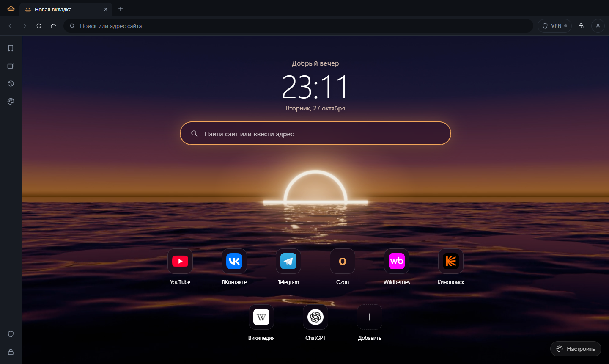

## Скачать

👉 **[Скачать Horizon для Windows](https://github.com/Sait5/horizon-browser/releases/latest/download/Horizon-Setup-0.2.1.exe)**
(или откройте раздел [Releases](https://github.com/Sait5/horizon-browser/releases) справа и скачайте файл `Horizon-Setup-…exe`).

Нужен Windows 10 или 11 (64-бит). Права администратора не нужны.

## Horizon для телефона (iPhone и Android)

Откройте на телефоне 👉 **https://horizon-web-lovat.vercel.app** — та же главная с волнами, плитки любимых сайтов, наш поиск со всеми вкладками и скачивание картинок.
Его можно добавить на экран «Домой» — он будет открываться со своим значком и на весь экран, как приложение.

  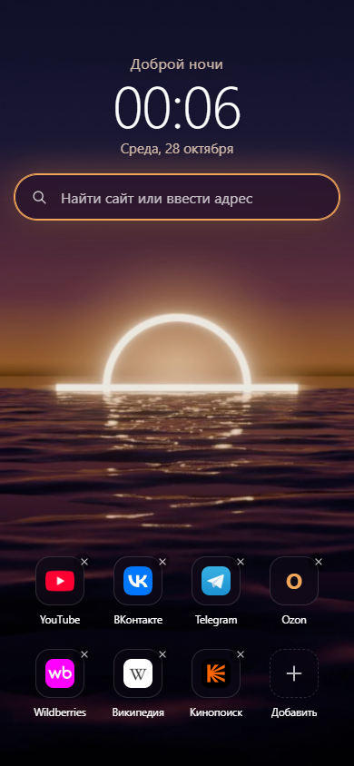
  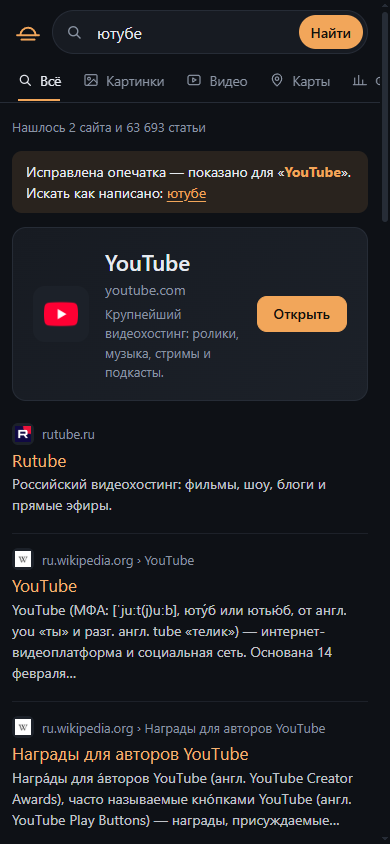
  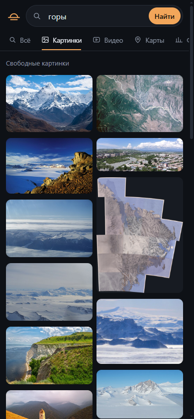
  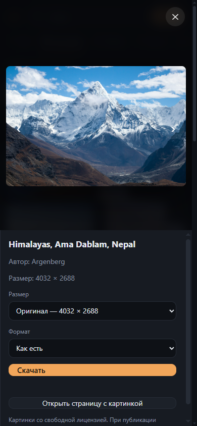

### Как добавить на iPhone
1. Откройте ссылку выше именно в **Safari** (в других браузерах на iPhone этого пункта может не быть).
2. Нажмите кнопку **«Поделиться»** — квадрат со стрелкой вверх (внизу экрана; на iPad — вверху).
3. Пролистайте список и выберите **«На экран „Домой“»**.
4. Оставьте название **Horizon** и нажмите **«Добавить»**. Если есть переключатель «Открывать как веб-приложение» — оставьте его включённым.
5. Готово: значок Horizon с восходом появится на экране «Домой».

### Как добавить на Android
1. Откройте ссылку в **Chrome**.
2. Нажмите **⋮** (три точки справа вверху) → **«Добавить на главный экран»** или **«Установить приложение»**.
3. Подтвердите — значок появится на главном экране.

На телефоне в этой версии нет VPN и сейфа паролей: телефон не разрешает сайтам их делать. Плитки сохраняются только на вашем телефоне.

## Как установить на Windows

1. Запустите скачанный файл `Horizon-Setup-0.2.1.exe`.
2. Windows может показать синее окно **«Система Windows защитила ваш компьютер»** — так бывает со всеми новыми программами без платной цифровой подписи.
   Нажмите **«Подробнее» → «Выполнить в любом случае»**.
3. Установщик спросит подтверждение и папку — нажмите **«Далее»** и **«Установить»**.
   ⏳ Установка займёт немного времени (обычно 1–2 минуты): внутри полноценный движок браузера, как у Chrome и Яндекс.Браузера, поэтому файл большой. Извините за ожидание и спасибо за терпение!
4. Готово: на рабочем столе появится значок **Horizon**. Браузер ставится только для вашей учётной записи Windows — у других пользователей компьютера свой профиль.

При первом запуске покажется короткая заставка «Восход над горизонтом» (её можно пропустить и выключить в «Оформлении»).

## Как пользоваться

### Поиск
Пишите в адресной строке или в поле на главной — что угодно: «погода», «рецепт борща», «youtube».
Браузер сам не перескакивает на сайт — вы видите выдачу и выбираете сами. Опечатки исправляются («ютубе» → YouTube, «барщ» → борщ).

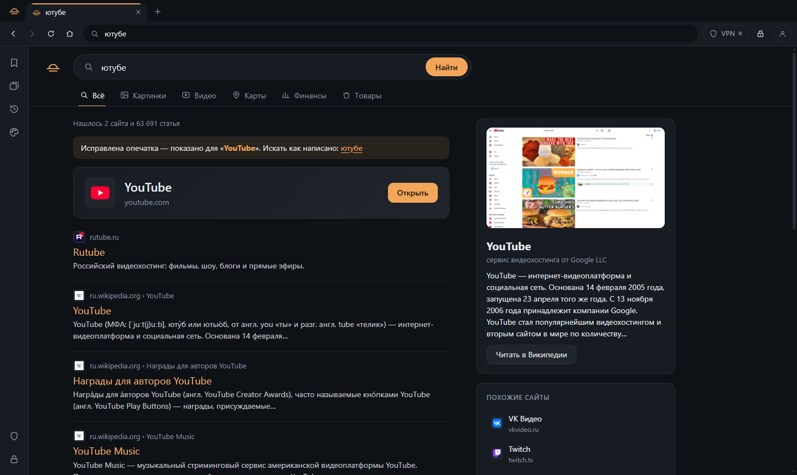

Вкладки над выдачей:
- **Всё** — сайты, статьи Википедии, справка и похожие сайты справа;
- **Картинки** — нажмите на картинку, чтобы открыть её крупно и **скачать в нужном размере и формате** (JPEG, PNG, WEBP или как есть);
- **Видео** — ролики и кнопки «Искать на YouTube / Rutube / VK Видео»;
- **Карты**, **Финансы** (курсы валют и криптовалют, «100 долларов в рублях») и **Товары** (поиск сразу во всех магазинах).

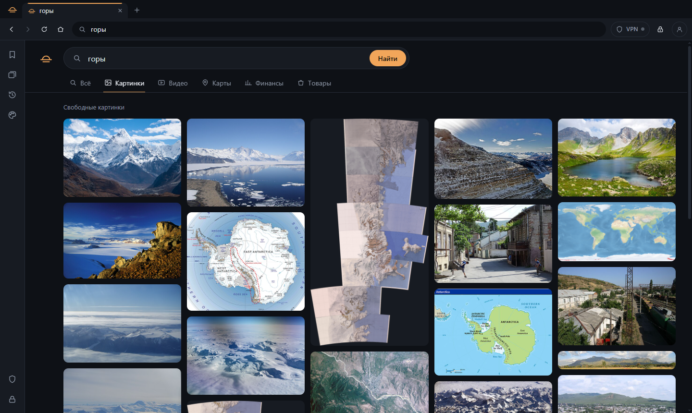
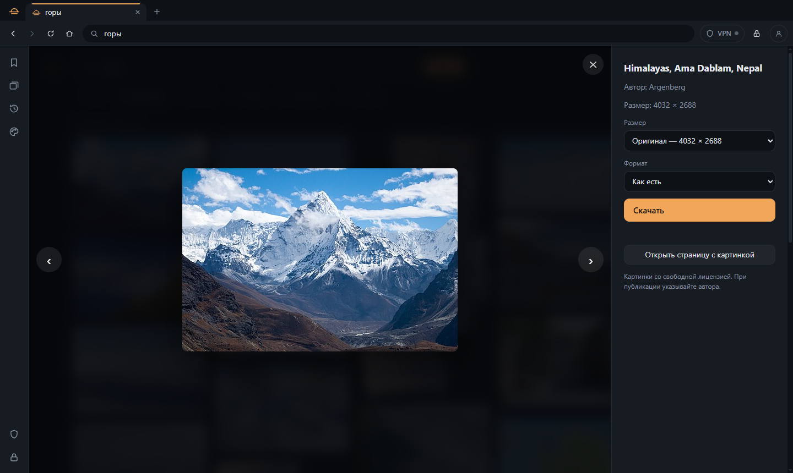
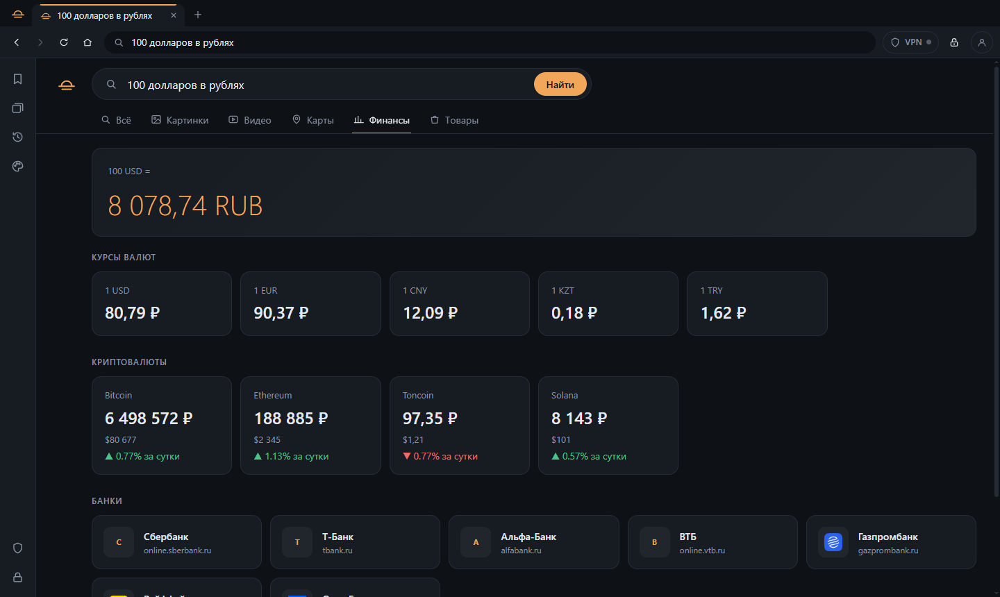

### Сайты на главной
Нажмите **«Добавить»** на главной: отметьте сразу несколько популярных сайтов или вставьте свою ссылку (например, канал на YouTube).
Чтобы убрать плитку — наведите на неё и нажмите крестик.

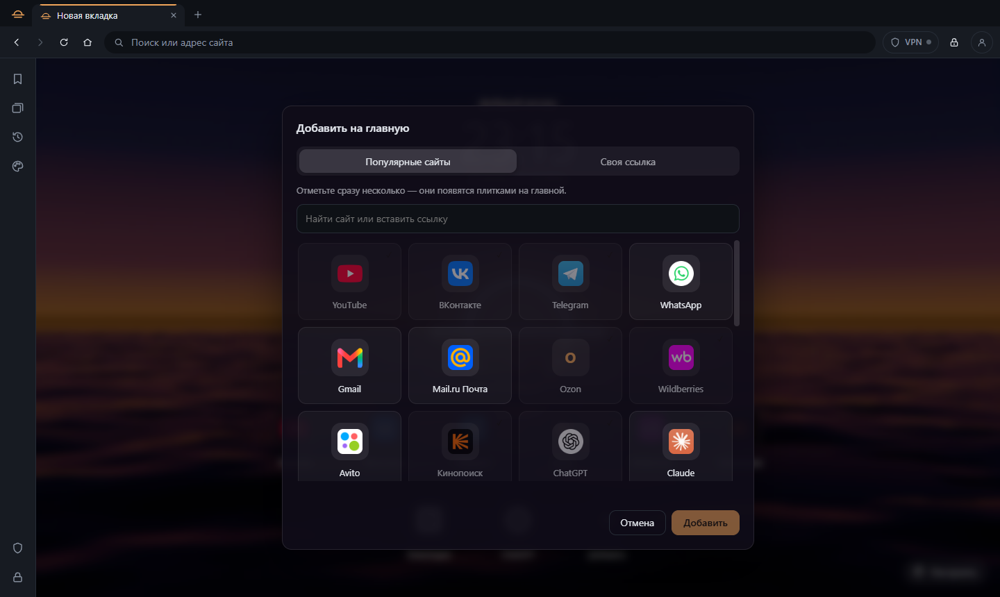

### Панель слева
- 🔖 **Сохранённые вкладки** — звёздочка в адресной строке сохраняет текущий сайт;
- 🗂 **Группы вкладок** — сохраните все открытые вкладки одной группой («Работа», «Учёба») и открывайте разом;
- 🕘 **История** (Ctrl+H) — что вы искали и где были, по дням. «Очистить всю историю» стирает её полностью;
- 🎨 **Оформление** — темы, цвета, обои (свои картинки тоже), анимации и заставка.

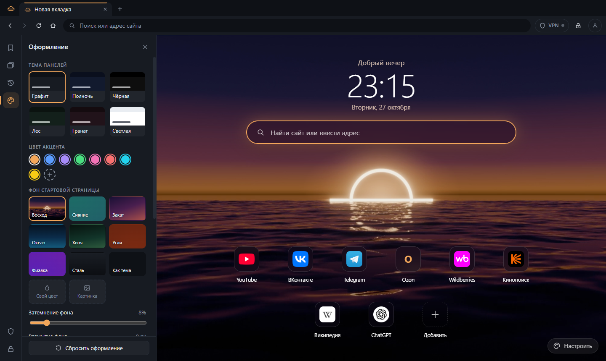
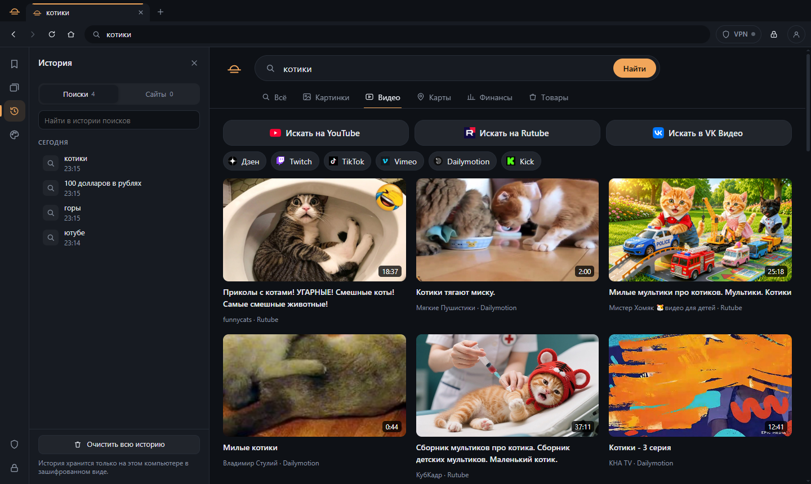

### Сейф паролей (замок справа вверху)
1. Придумайте мастер-пароль — сейф покажет **код восстановления**: запишите его на бумагу.
2. Когда вы входите на сайт, браузер предложит сохранить пароль. В следующий раз он подставит его — только на том же сайте и только после вашего подтверждения.
3. Сейф можно открывать отпечатком, лицом или PIN-кодом (Windows Hello). Он сам закрывается через 15 минут и при блокировке компьютера.
4. Для большей защиты включите подтверждение с телефона (приложения 2FAS, Google Authenticator и подобные).

Пароли хранятся только на вашем компьютере в зашифрованном виде и никуда не отправляются.

### VPN (щит справа вверху)
Вставьте свой ключ или ссылку на подписку (VLESS, VMess, Trojan, Shadowsocks, формат HAPP) — через VPN пойдёт только трафик браузера.
Если VPN оборвётся, сайты не откроются напрямую, пока вы его не переподключите — ваш адрес не утечёт.

### Аккаунт (необязательно)
Значок человечка справа вверху. Аккаунт нужен для профиля и подтверждённого номера телефона (через Telegram-бота **@HorizonIDbot** — номер передаёт сам Telegram).
При регистрации указывается дата рождения: **до 18 лет включается детский режим** — сайты для взрослых не открываются, в поиске нет материалов 18+, VPN недоступен.
Забыли пароль — код для нового придёт от бота в Telegram.

## Горячие клавиши

| Клавиши | Действие |
|---|---|
| Ctrl+T | Новая вкладка |
| Ctrl+W | Закрыть вкладку |
| Ctrl+Shift+T | Вернуть закрытую вкладку |
| Ctrl+L | Перейти в адресную строку |
| Ctrl+F | Поиск на странице |
| Ctrl+H | История |
| Ctrl + / Ctrl − / Ctrl 0 | Масштаб |
| F11 | Во весь экран |

## Обновления
Браузер сам проверяет новые версии на этой странице и ставит обновление после закрытия. Каждое обновление подписано — подменить его нельзя.

## Безопасность и приватность
- История, вкладки и пароли хранятся только на вашем компьютере в зашифрованном виде.
- Поиск не следит за вами и не показывает рекламу.
- Сайт не может без вашего нажатия скачать файл или открыть всплывающее окно.
